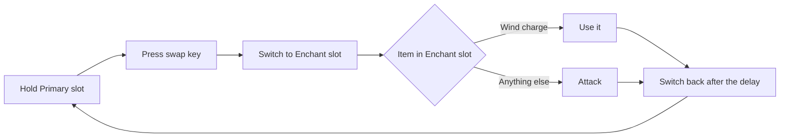

<p align="center">
  
</p>

<p align="center">
  <a href="../../releases/latest"></a>
</p>

<p align="center">
  
  
  
  
  
</p>

<p align="center"><b>One key. Swap. Strike. Swap back.</b></p>

<p align="center">
  <a href="#quick-start">Quick start</a> |
  <a href="#how-it-works">How it works</a> |
  <a href="#features">Features</a> |
  <a href="#example-setups">Setups</a> |
  <a href="#faq">FAQ</a> |
  <a href="#official-links">Links</a>
</p>

---

## What is Atty?
Atty is a client-side **Fabric** mod for **Minecraft 1.21.11** that automates a weapon swap. Hold your **Primary** slot, press your swap key, and Atty switches to your **Enchant** slot, performs the action, then switches back. It is built for practicing combos like sword + breach mace and spear + wind charge.

> Made By Mohzy :)

## Quick start
1. Install [Fabric Loader](https://fabricmc.net/use/) for 1.21.11 and put [Fabric API](https://modrinth.com/mod/fabric-api) in your `mods` folder.
2. Download `atty-1.0.0.jar` from the [Releases](../../releases) page and put it in the same `mods` folder.
3. Launch the game, join a world and press **Right Shift** to open Atty.

## How it works


1. Open the GUI (Right Shift) and press **Enable**.
2. Pick your **Primary Slot** and **Enchant Slot**, and click the swap key button to set a key (default `R`).
3. Stand on your Primary slot and press the swap key. Atty does the rest.
4. Pressing the swap key on any other slot does nothing.

## Features
| | Feature | Details |
|---|---|---|
| :art: | Custom GUI | Hand-drawn interface with an animated header, not the vanilla look |
| :green_circle: | Live status | Pulsing Active / Disabled indicator with green Enable and red Disable buttons |
| :keyboard: | Rebindable keys | Right Shift opens the GUI (Controls menu), and you set the swap key inside the GUI |
| :video_game: | Hotbar slot pickers | Choose any slot from 1 to 9, with your real items shown in the picker |
| :stopwatch: | Return delay | Choose 1 to 10 ticks before it swaps back |
| :robot: | Fully automatic | Swap, action and swap back with a single press |
| :floppy_disk: | Saved settings | Everything is stored in `config/atty.json` |
| :electric_plug: | Client-side only | Nothing to install on a server |

## GUI layout
A sketch of what the screen contains (not a screenshot):
```
+--------------------------------------------+
| ATTY  Auto Attribute Swapper    v1.0       |
| ------------------------------------------ |
| STATUS                                     |
| [ * ACTIVE ]            [Enable] [Disable] |
|                                            |
| SWAP KEY                RETURN DELAY       |
| [ R ]                   [-]  2 ticks  [+]  |
|                                            |
| SLOTS                                      |
| Primary Slot                               |
| [1] [2] [3] [4] [5] [6] [7] [8] [9]        |
| Enchant Slot                               |
| [1] [2] [3] [4] [5] [6] [7] [8] [9]        |
|        Slot 1 -> Slot 2 (attack) -> Slot 1 |
|                                            |
| CAUTION: educational / practice use only   |
|          Made By Mohzy :)                  |
+--------------------------------------------+
```
<!-- Add real screenshots here once you have them:

-->

## Example setups
| Primary slot | Enchant slot | Action |
|---|---|---|
| Sword | Breach mace | Attack |
| Spear | Another weapon | Attack |
| Any item | Wind charge | Use |

## Controls
| Control | Default | Where to change it |
|---|---|---|
| Open the Atty GUI | `Right Shift` | Options > Controls > Atty (Auto Attribute Swapper) |
| Swap key | `R` | Inside the Atty GUI (click the key button, then press a key) |

## Configuration
Saved automatically to `config/atty.json`.

| Option | Default | Meaning |
|---|---|---|
| `enabled` | `true` | Turns the swapper on or off |
| `primarySlot` | `1` | Hotbar slot (1-9) you press the swap key from |
| `enchantSlot` | `2` | Hotbar slot (1-9) it swaps to |
| `swapKey` | `82` (R) | Key code of the swap key |
| `returnDelay` | `2` | Ticks to wait before swapping back (1-10) |

## Caution
**For educational and practice use only.** Automatic swapping and attacking can be treated as cheating on multiplayer servers and can get you **banned**. Use it in singleplayer or on servers where it is allowed, and check the server's rules first. You use this mod at your own risk.

## FAQ
<details>
<summary><b>Does it work in singleplayer and multiplayer?</b></summary>
<br>
Technically yes, because it only runs on your client. But many servers do not allow automatic swapping or attacking, so use it on multiplayer at your own risk.
</details>

<details>
<summary><b>Do I need Fabric API?</b></summary>
<br>
Yes. Put Fabric API in your <code>mods</code> folder next to Atty.
</details>

<details>
<summary><b>The swap key does nothing. Why?</b></summary>
<br>
Check that Atty is <b>Enabled</b>, that you are standing on your <b>Primary slot</b>, and that no menu or chat is open. The key only works from the Primary slot.
</details>

<details>
<summary><b>How do I change the key that opens the GUI?</b></summary>
<br>
Go to Options &gt; Controls &gt; Key Binds and look for <i>Atty (Auto Attribute Swapper)</i>.
</details>

<details>
<summary><b>Where are my settings saved?</b></summary>
<br>
In <code>config/atty.json</code> inside your Minecraft instance folder.
</details>

## Official links
Made by **Mohzy**. This GitHub repository is the only official source for Atty.

- YouTube: [Mohzy on YouTube](https://www.youtube.com/@mohzymc)

Atty is free. Only download it from this repository's [Releases](../../releases) page. Re-uploads on other sites are not made or endorsed by me, so be careful with them.

If you like the mod, consider giving the repo a star.

## Changelog
### 1.0.0
- First release
- Right Shift GUI with Enable/Disable, slot pickers, swap key and return delay
- Auto swap, act and swap back from the Primary slot

## License
All Rights Reserved, Mohzy.
